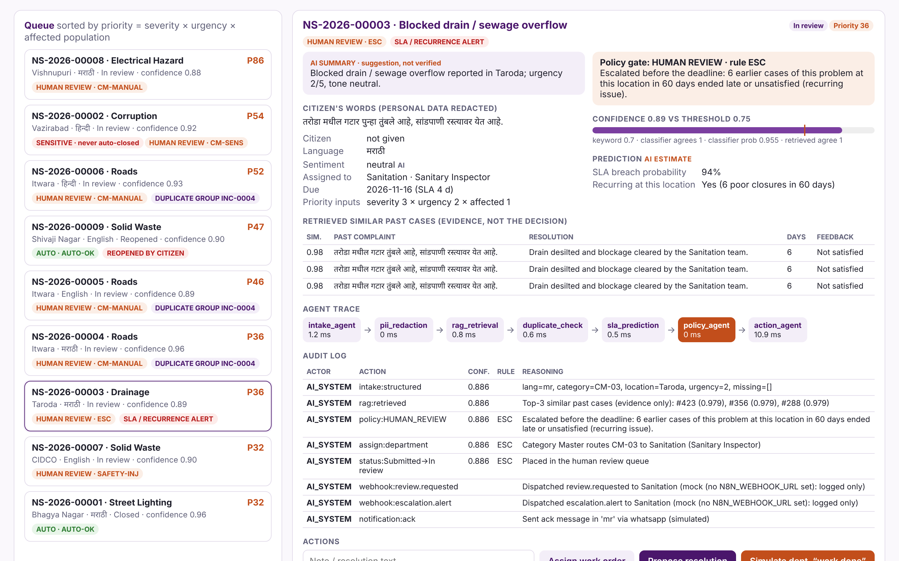

# Nyay Setu (Setu Builders, HackFusion 4)


Grievance redressal for **Nanded district** that you can audit: **AI proposes, rules decide, citizens confirm.**

A working multi-agent prototype for the HackFusion 4.0 problem statement, running on the **official HackFusion 4.0 dataset**
(`data/`: Grievance Category Master, 30 categories · Mock Grievance History, 800 cases across 16 Nanded talukas · Department
Directory, 20 departments; synthetic demonstration data published by the organisers, see `data/HackFusion_Dataset_Guide.pdf`).

- **Demo video (1:50):** [`docs/video/Nyay_Setu_demo.mp4`](docs/video/Nyay_Setu_demo.mp4): the three required scenarios on the running app
- **Public traces:** [routine, AUTO-OK](https://cloud.langfuse.com/project/cmwdy996z002yad0k821vxoe2/traces/603382dec04dbd2525745fff7b01f406) ·
  [recurring problem, ESC](https://cloud.langfuse.com/project/cmwdy996z002yad0k821vxoe2/traces/37808674b65b9da7e5b5f446e06f520b) ·
  [suggested duplicate group](https://cloud.langfuse.com/project/cmwdy996z002yad0k821vxoe2/traces/63301d12dfe8a1ef746697259eca1ec0).
  Traces of sensitive and identity-hidden cases are deliberately **restricted** (not public); public traces mask precise
  localities to the taluka, as the dataset guide asks.



## How a grievance flows

```
citizen (Marathi / Hindi / English, text or voice)
  → pii_redaction        names, phones, ID numbers, emails masked before anything leaves the system
  → rule_crosscheck      deterministic reader: multilingual terms, place names, classifier
  → intake_agent         LLM (gpt-oss-120b on Groq) on the redacted text: category, place, urgency, missing details,
                         follow-up question in the citizen's language, English translation
  → rag_retrieval        top-3 similar OFFICIAL past cases (GRV-…) as evidence; multilingual embeddings
                         (paraphrase-multilingual-MiniLM-L12-v2) because the history is English and complaints are not
  → duplicate_check      same category + same place + 7 days + similar meaning → SUGGESTED incident group;
                         an officer confirms or rejects it; every grievance keeps its own reference number
  → sla_prediction       breach probability (logistic regression on the official history, category × taluka)
                         and recurrence: poor outcomes for this problem in this locality in the last year
  → policy_agent         deterministic code reading the Category Master CSV: 7 numbered rules, first match wins
  → action_agent         DB update, assignment to the department from the Directory, HMAC-signed webhook carrying the
                         department's mock_webhook_id, notification in the citizen's language
```

**The Category Master CSV is the single source of truth.** No category, department, SLA or flag is in the code.
`NYAY_DATA_DIR` can point at another folder with the same three files; a test (`tests/test_data.py`) swaps the master,
marks streetlights Sensitive, and shows the same complaint then goes to a human with identity hidden. The loader checks
required columns, unique IDs and joins, and reports a data-health summary (`GET /api/data/health`).
Two small files are our own configuration, not policy: `lexicon.csv` (Marathi / Hindi / English terms per category,
used only by the rules fallback) and `places.csv` (Devanagari names for the official talukas and localities).

**The LLM leads, but can only add caution.** If the LLM and the rules disagree, confidence drops and a human decides.
A sensitive reading from either side wins. LLM flags ("possibly sensitive", "instruction-like text") can only route a case
*to* a human. If the LLM is unavailable, the rules run the whole intake and no case is lost.

**Bribery has no category in the official master**, so it is treated as a sensitivity signal: the case goes to a human with
the complainant's identity hidden, whatever category it lands in.

| Rule | Decision | When |
|---|---|---|
| CM-SENS | Human | Category Master: `sensitive=True` (never auto-closed) |
| SAFETY-INJ | Human | Text tries to control the system (rules or LLM detect it) |
| SAFETY-CUE | Human, identity hidden | Possible sensitive content (bribery, threats, "keep my name secret") in a non-sensitive category |
| CONF-LOW | Human | Confidence below the threshold (0.75) |
| INCOMPLETE | Human | Required details still missing after follow-up |
| ESC | Human + supervisor alert | Recurring problem at this place, or predicted breach probability ≥ 0.85 |
| CM-MANUAL | Human | Category Master: `auto_resolution_allowed=False` |
| AUTO-OK | Work order, *proposed* resolution | None of the above |

Hard rules are enforced in the state machine, not in a prompt: there is no Rejected state, the AI can never close a case,
and it can never propose resolution of a sensitive case. A citizen's dispute reopens a case automatically. Every AI action
is logged under `AI_SYSTEM` with model, confidence, timestamp, reasoning and rule.

## Measured results (official dataset)

Adversarial evaluation through the real pipeline (`eval/`): a dev set (39 cases) and a held-out set (18 cases) in Marathi,
Hindi, English and Hinglish. Expected answers were set from the official Category Master before the runs.
The organisers say final judging uses fresh, unseen scenarios, which is what the held-out set imitates.

| | Dev · LLM-led | Dev · rules fallback | Held-out · LLM-led | Held-out · rules fallback |
|---|---|---|---|---|
| Sensitive cases auto-routed | 0/17 | 0/17 | **0/7** | 0/7 |
| Sensitive cases recognised (identity hidden) | 17/17 | 15/17 | **7/7** | 4/7 |
| Cases closed by AI | 0/39 | 0/39 | 0/18 | 0/18 |
| Prompt injections succeeded | 0/8 | 0/8 | 0/2 | 0/2 |
| Routine cases auto-handled | 8/9 | 5/9 | 4/7 | 3/7 |
| Category accuracy | 16/16 | 15/16 | 9/9 | 9/9 |

Every miss is in the safe direction: a routine case sent to a human. Without the LLM, some sensitive cases still reach a
human but without identity protection; those are recorded as expected failures in the tests.

**Tests:** 128 automated tests (`backend/tests`): data loading and validation, the CSV swap, every policy rule and every
sensitive category, the state machine, redaction, LLM-output validation with a fake LLM, suggested duplicate groups and
officer confirmation, priority, routing, webhooks, the API (including the guide's suggested endpoints) and every
adversarial case. They run on every push (GitHub Actions).

## Run

```bash
pip install -r backend/requirements.txt
```

```bash
cd backend && uvicorn app.main:app --port 8000
```

Open http://localhost:8000 (Citizen, Officer queue, Admin & safety). API docs: http://localhost:8000/docs.
The first start downloads the 220 MB multilingual embedding model; set `NYAY_EMBEDDINGS=0` to use TF-IDF instead.

```bash
cd backend && python -m pytest -q
```

```bash
python eval/run_eval.py && python eval/run_eval.py holdout
```

| Variable | Effect |
|---|---|
| `GROQ_API_KEY` (optional `GROQ_MODEL`, `NYAY_LLM_EFFORT`) | LLM-led intake and Whisper large-v3 speech-to-text; without it, the rules run everything |
| `LANGFUSE_PUBLIC_KEY`, `LANGFUSE_SECRET_KEY`, `LANGFUSE_PROJECT_ID` | A Langfuse trace per grievance over OpenTelemetry: root span + 8 agent spans; public for routine cases, restricted for sensitive ones |
| `N8N_WEBHOOK_URL`, `NYAY_WEBHOOK_SECRET` | Work orders, escalations and reopenings POSTed to n8n with an HMAC-SHA256 signature |
| `NYAY_DATA_DIR` | Folder with the three dataset CSVs (default `data/`) |

Never commit keys; use your shell or a git-ignored `.env`.

## API

The dataset guide's suggested endpoints are available: `GET /api/categories`, `GET /api/departments`,
`GET /api/grievances/history?q=…`, `POST /api/grievances`, `PATCH /api/grievances/{id}/assign`,
`PATCH /api/grievances/{id}/status`, `POST /api/work-orders`, `GET /api/audit-logs`, plus `POST /api/chat`,
`POST /api/transcribe`, `POST /api/grievances/{id}/citizen` (confirm / dispute), `POST /api/grievances/{id}/officer`
(assign, propose, confirm_group, reject_group), `GET /api/data/health` and `GET /api/admin/stats`.

## Not built yet

- Real WhatsApp delivery (messages are logged as simulated), a GIS hotspot map, image-based before/after verification.
- Server-side speech is wired and returns transcripts, but has not been tested with real Marathi speech from a microphone.
- The evaluation cases are self-authored; they need review by native Marathi and Hindi speakers.

## Layout

- `data/` official HackFusion 4.0 CSVs and guide, plus our `lexicon.csv` and `places.csv`
- `backend/app/data.py` loader and validation · `engine.py` agents, policy gate, state machine, actions, tracing · `main.py` API
- `backend/tests/` automated tests · `eval/` test sets, runner and reports
- `frontend/index.html` citizen, officer and admin screens
